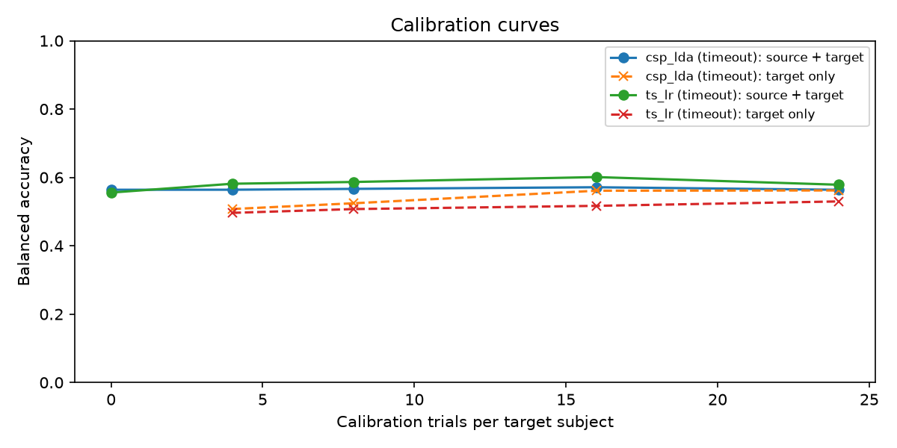

# Motor imagery model results

Balanced accuracy, mean ± standard deviation. Counts are the number of finished subjects or folds (`len(per_subject)` or `len(per_fold)`). A status of partial means the model did not finish all evaluation steps.

| Model | Status | Within subject | Cross subject | Permuted within | Permuted cross | Calibration k completed |
|---|---|---:|---:|---:|---:|---|
| csp_lda | ok | 0.5479 ± 0.1653 (n=20) | 0.5588 ± 0.0346 (n=5) | 0.4902 | 0.5047 | 0, 4, 8, 16, 24 |
| fbcsp_lr | ok | 0.5645 ± 0.1285 (n=20) | 0.5597 ± 0.0477 (n=5) | 0.5075 | 0.5103 | 0, 4, 8, 16, 24 |
| ts_lr | ok | 0.5513 ± 0.1396 (n=20) | 0.5534 ± 0.0471 (n=5) | 0.4972 | 0.5030 | 0, 4, 8, 16, 24 |
| eegnet_lite | ok | 0.5435 ± 0.0826 (n=20) | 0.7072 ± 0.0784 (n=5) | 0.5039 | 0.4790 | — |

## Calibration values

Only completed calibration points are shown. Scores are balanced accuracy.

| Model | Status | k | Source + target | Target only |
|---|---|---:|---:|---:|
| csp_lda | ok | 0 | 0.5639 | — |
| csp_lda | ok | 4 | 0.5640 | 0.5075 |
| csp_lda | ok | 8 | 0.5665 | 0.5243 |
| csp_lda | ok | 16 | 0.5712 | 0.5610 |
| csp_lda | ok | 24 | 0.5638 | 0.5619 |
| fbcsp_lr | ok | 0 | 0.5506 | — |
| fbcsp_lr | ok | 4 | 0.5549 | 0.5015 |
| fbcsp_lr | ok | 8 | 0.5579 | 0.5145 |
| fbcsp_lr | ok | 16 | 0.5628 | 0.5184 |
| fbcsp_lr | ok | 24 | 0.5775 | 0.5291 |
| ts_lr | ok | 0 | 0.5557 | — |
| ts_lr | ok | 4 | 0.5815 | 0.4963 |
| ts_lr | ok | 8 | 0.5866 | 0.5074 |
| ts_lr | ok | 16 | 0.6010 | 0.5168 |
| ts_lr | ok | 24 | 0.5785 | 0.5297 |

## Paired comparisons

Wilcoxon signed-rank on matched within-subject balanced accuracies; median difference is model minus csp_lda. Holm step-down adjusts p-values across the 3 completed-model comparisons.

| Model | Median difference | Raw p | Holm p |
|---|---:|---:|---:|
| fbcsp_lr | 0.0208 | 0.3719 | 1.0000 |
| ts_lr | -0.0459 | 0.8408 | 1.0000 |
| eegnet_lite | 0.0336 | 0.8408 | 1.0000 |

## Responder analysis

Responder rule: subject-level permutation p-value is below the pre-specified alpha.

| Subject | Balanced accuracy | Permutation p | Responder |
|---:|---:|---:|---|
| 1 | 0.5810 | 0.1493 | no |
| 2 | 0.8883 | 0.0050 | yes |
| 3 | 0.6018 | 0.1244 | no |
| 4 | 0.5109 | 0.4129 | no |
| 5 | 0.4435 | 0.7811 | no |
| 6 | 0.3929 | 0.9204 | no |
| 7 | 0.9783 | 0.0050 | yes |
| 8 | 0.5781 | 0.1294 | no |
| 9 | 0.4435 | 0.7861 | no |
| 10 | 0.6429 | 0.0398 | yes |
| 11 | 0.4881 | 0.6269 | no |
| 12 | 0.4137 | 0.9055 | no |
| 13 | 0.5978 | 0.1393 | no |
| 14 | 0.3113 | 0.9652 | no |
| 15 | 0.6423 | 0.0697 | no |
| 16 | 0.4457 | 0.7214 | no |
| 17 | 0.3350 | 0.9851 | no |
| 18 | 0.4654 | 0.7363 | no |
| 19 | 0.6008 | 0.1144 | no |
| 20 | 0.5978 | 0.1294 | no |

Responders: 3 of 20; 95% Clopper-Pearson interval [0.0321, 0.3789]. Expected false positives: 1.0000.

## Calibration gain by responder group

Gain is source-plus-target score minus that target's k=0 score. The difference is responders minus non-responders.

| k | Responders | Non-responders | Difference | 95% bootstrap CI |
|---:|---:|---:|---:|---|
| 0 | 0.0000 | 0.0000 | 0.0000 | [0.0000, 0.0000] |
| 4 | -0.0063 | 0.0012 | -0.0075 | [-0.0637, 0.0501] |
| 8 | 0.0135 | 0.0007 | 0.0129 | [-0.0291, 0.0683] |
| 16 | 0.0403 | 0.0016 | 0.0388 | [-0.0175, 0.1198] |
| 24 | 0.0234 | -0.0042 | 0.0277 | [-0.0576, 0.0982] |

## ERD lateralization

LS is the pre-specified C3/C4 mu-band lateralization score; negative is the expected healthy-sign direction.

| Subject | LS |
|---:|---:|
| 1 | -0.6022 |
| 2 | -0.3447 |
| 3 | 0.1382 |
| 4 | -0.5038 |
| 5 | 0.0675 |
| 6 | 0.0293 |
| 7 | -0.9495 |
| 8 | -0.3227 |
| 9 | 0.0482 |
| 10 | -0.6246 |
| 11 | 0.1465 |
| 12 | 0.3026 |
| 13 | -0.3570 |
| 14 | -0.0899 |
| 15 | -0.2982 |
| 16 | -0.0268 |
| 17 | 0.0775 |
| 18 | -0.0205 |
| 19 | -0.3177 |
| 20 | -0.1888 |

Spearman LS versus within-subject balanced accuracy: rho -0.6351, p 0.0026, n=20.

The responder calibration comparison is observational and subject selection can cause regression to the mean.

## Figures

## Limits

The results metadata lists 20 subjects and 900 total trials. The subjects are healthy volunteers. Statistical power is limited by the cohort size. These results do not establish clinical benefit or performance for a stroke cohort.
