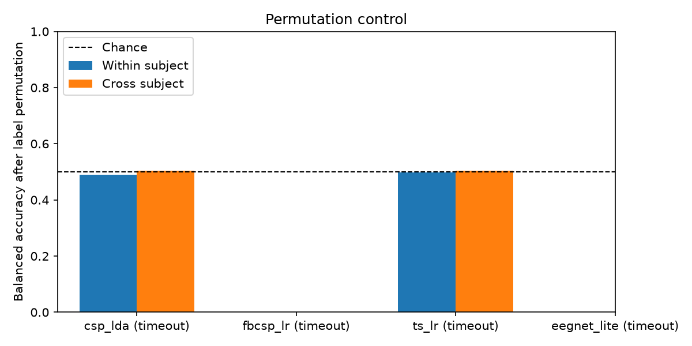

# Motor imagery model results

Balanced accuracy, mean ± standard deviation. Counts are the number of finished subjects or folds (`len(per_subject)` or `len(per_fold)`). A status of partial means the model did not finish all evaluation steps.

| Model | Status | Within subject | Cross subject | Permuted within | Permuted cross | Calibration k completed |
|---|---|---:|---:|---:|---:|---|
| csp_lda | partial (timeout) | 0.5479 ± 0.1653 (n=20) | 0.5588 ± 0.0346 (n=5) | 0.4902 | 0.5047 | 0, 4, 8, 16, 24 |
| fbcsp_lr | partial (timeout) | 0.5645 ± 0.1285 (n=20) | 0.5597 ± 0.0477 (n=5) | — | — | — |
| ts_lr | partial (timeout) | 0.5513 ± 0.1396 (n=20) | 0.5534 ± 0.0471 (n=5) | 0.4972 | 0.5030 | 0, 4, 8, 16, 24 |
| eegnet_lite | partial (timeout) | 0.5435 ± 0.0826 (n=20) | — | — | — | — |

## Calibration values

Only completed calibration points are shown. Scores are balanced accuracy.

| Model | Status | k | Source + target | Target only |
|---|---|---:|---:|---:|
| csp_lda | timeout | 0 | 0.5639 | — |
| csp_lda | timeout | 4 | 0.5640 | 0.5075 |
| csp_lda | timeout | 8 | 0.5665 | 0.5243 |
| csp_lda | timeout | 16 | 0.5712 | 0.5610 |
| csp_lda | timeout | 24 | 0.5638 | 0.5619 |
| ts_lr | timeout | 0 | 0.5557 | — |
| ts_lr | timeout | 4 | 0.5815 | 0.4963 |
| ts_lr | timeout | 8 | 0.5866 | 0.5074 |
| ts_lr | timeout | 16 | 0.6010 | 0.5168 |
| ts_lr | timeout | 24 | 0.5785 | 0.5297 |

## Paired comparisons

Wilcoxon signed-rank on matched within-subject balanced accuracies; median difference is model minus csp_lda. Holm step-down adjusts p-values across the 0 completed-model comparisons.

| Model | Median difference | Raw p | Holm p |
|---|---:|---:|---:|

No paired comparison is available because no completed model can be compared with a completed csp_lda baseline; timed-out and errored models remain visible in the measurements above.

## Figures

## Limits

The results metadata lists 20 subjects and 900 total trials. The subjects are healthy volunteers. Statistical power is limited by the cohort size. These results do not establish clinical benefit or performance for a stroke cohort.
