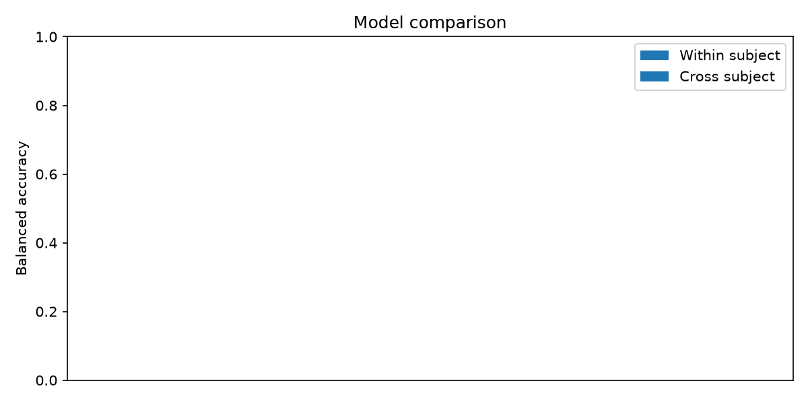

# Motor imagery model results

Balanced accuracy, mean ± standard deviation:

| Model | Within subject | Cross subject |
|---|---:|---:|
| csp_lda | timeout | timeout |
| fbcsp_lr | timeout | timeout |
| ts_lr | timeout | timeout |
| eegnet_lite | timeout | timeout |

## Paired comparisons

Wilcoxon signed-rank on matched within-subject balanced accuracies; median difference is model minus csp_lda. Holm step-down adjusts p-values.

| Model | Median difference | Raw p | Holm p |
|---|---:|---:|---:|

## Figures

## Limits

The intended PhysioNet cohort contains 20 healthy subjects with about 45 trials each. Statistical power is low. These results do not establish clinical benefit or performance for a stroke cohort.
